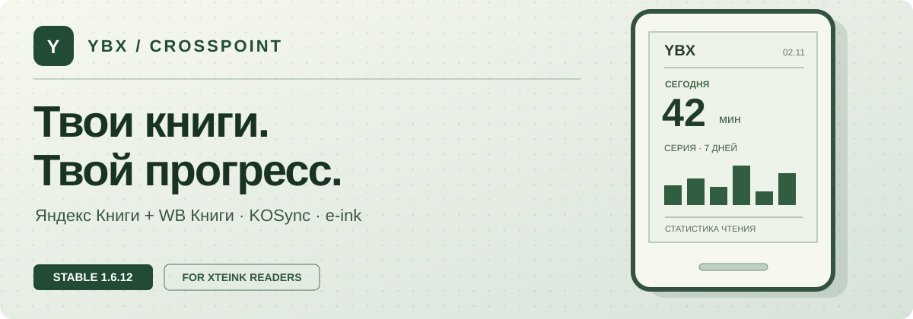
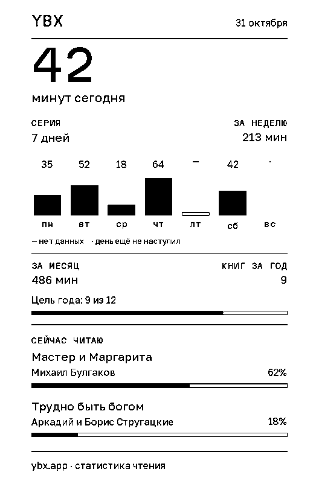
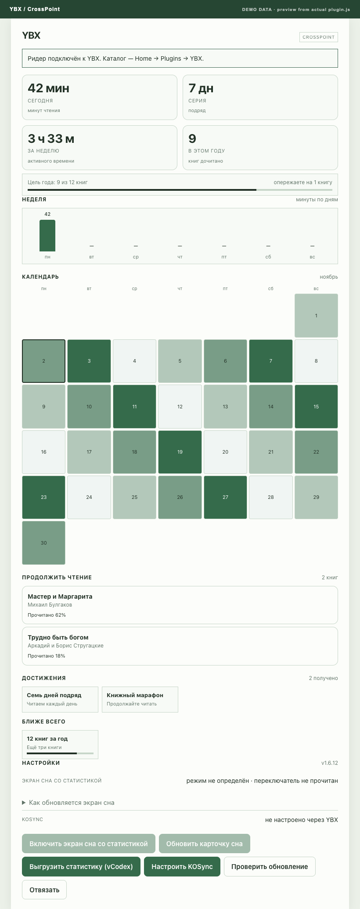
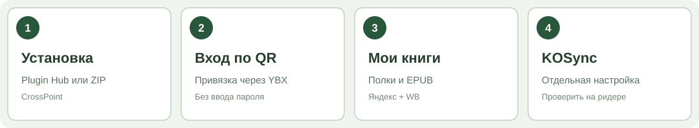

<div align="center">
  

  <p><strong>YBX CrossPoint Plugin</strong> — библиотеки Яндекс Книг и WB Книг на ридере с прошивкой CrossPoint.</p>

  <p>
    <a href="https://github.com/jhdvp/ybx-crosspoint-plugin/releases/latest"></a>
    <a href="https://github.com/jhdvp/ybx-crosspoint-plugin/actions/workflows/validate.yml"></a>
    
  </p>

  <p><a href="https://github.com/jhdvp/ybx-crosspoint-plugin/releases/latest"><b>Скачать</b></a> &nbsp;·&nbsp; <a href="https://ybx.app/installer"><b>Установить</b></a> &nbsp;·&nbsp; <a href="docs/INSTALL.md">Инструкция</a> &nbsp;·&nbsp; <a href="docs/STATUS.md">Статус</a> &nbsp;·&nbsp; <a href="docs/TROUBLESHOOTING.md">Помощь</a></p>
</div>

---

> **Две разные редакции:** этот репозиторий — только **YBX Stock** (официальный CrossPoint, стабильная 1.6.13, новая 1.6.14 RC в PR). **YBX Native 1.9.1** развивается в нашей кастомной YBX Reader и не подходит для установки на стоковую прошивку. [Матрица совместимости и правила выпуска →](docs/EDITIONS.md)

## Библиотека, прогресс, статистика

<table><tr><td width="50%">
<h3>01 · Мои книги</h3>
Статические «Все книги», «Читаю», «Хочу прочитать», «Прочитано»,
«Загруженные», Яндекс Книги, WB Книги и ЛитРес в 1.6.14 RC.
Выпуск остаётся 1.6.13 до серверной и аппаратной приёмки.
</td><td width="50%">
<h3>02 · KOSync</h3>
Обмен позициями через YBX с отдельным ограниченным ключом для ридеров без надёжной поддержки HTTPS. Включается по желанию.
</td></tr><tr><td>
<h3>03 · Статистика</h3>
Минуты чтения, серия, недельный график, календарь, годовая цель, достижения и список текущих книг.
</td><td>
<h3>04 · Экран сна</h3>
Опциональная e-ink карточка с сохранением выбранного режима после обновления и защитой чужих обоев.
</td></tr></table>

### Как это выглядит

<table><tr>
<td width="47%" align="center" valign="top"><br><sub>Реальный рендер карточки YBX</sub></td>
<td width="53%" align="center" valign="top"><br><sub>Настоящий интерфейс plugin.js, демонстрационные данные</sub></td>
</tr></table>

## Начало работы



1. Установите YBX через **Plugin Hub** или [последний ZIP](https://github.com/jhdvp/ybx-crosspoint-plugin/releases/latest).
2. На ридере откройте **Home → Plugins → YBX**, отсканируйте QR-код и привяжите устройство.
3. Подключите источники в [кабинете YBX](https://my.ybx.app) и откройте полки на ридере.
4. Для двустороннего прогресса настройте **KOSync** отдельно и проверьте чтение удалённой позиции на самом ридере.

**Где настройки CrossPoint 2.0?** Включите Wi-Fi и File Transfer. С телефона или компьютера в той же сети откройте `http://crosspoint.local/plugins` (или `http://IP-ридера/plugins`) → карточка **YBX**.

> **Важно:** автоматическая отправка позиции через зеркало CrossPoint Sync ещё не означает, что обратная позиция читается ридером. Необходим настроенный KOSync и реальный тест `Sync Progress`.

В веб-настройках YBX доступна проверка **«KoSync V2 (без изменений)»**: она только читает возможности прошивки и не включает V2. На старых стоковых прошивках KOSync продолжает работать в Legacy-режиме. [Подробности и ограничения →](docs/KOSYNC_V2_CLIENT_READINESS_20261104.md).

[Пошаговая установка →](docs/INSTALL.md) · [Типичные проблемы →](docs/TROUBLESHOOTING.md)

## Текущий статус

<sub>Обновлено 10 ноября 2026 · стабильный релиз 1.6.16</sub>

| Возможность | Состояние |
| --- | --- |
| Полки, поиск, QR-авторизация, EPUB | ✅ Реализовано |
| Веб-панель чтения, календарь, достижения | ✅ Реализовано |
| Экран сна: включение, выключение, сохранение выбора | ✅ Реализовано |
| HTTP KOSync с отдельным токеном `kosync_` | ✅ Реализовано и покрыто серверными тестами |
| **Обратный прогресс на физическом X4 Pro / CrossPoint 2.0** | ◌ **Требует проверки** |
| Отдельная полка ЛитРес непосредственно в плагине | △ Реализуется в 1.6.14 RC; не опубликовано в stable |
| Полное сохранение входа при замене папки через Plugin Hub | △ Зависит от метода обновления |

**Новое в 1.6.16:** цитаты включаются и при работе через зеркало в Европе —
плагин принимает и сохраняет адрес цитат, выданный сервером (основной или
европейский), и отзывает ключ по тому же адресу.

**Новое в 1.6.13:** статистика, достижения и календарь загружаются напрямую по HTTPS браузером телефона — без TLS на ESP32. Исправления KOSync и экрана сна из 1.6.12 сохранены.

[Полная матрица возможностей и roadmap →](docs/STATUS.md)

## Поддерживаемые устройства

Основной публичный профиль ориентирован на **Xteink X3 / X4 / X4 Pro** с CrossPoint 1.6.x и 2.0 RC, а также другие устройства с соответствующими возможностями Plugin API. Реальная поддержка зависит от сборки прошивки и её веб-интерфейса. Тесты исходников не равнозначны проверке на физическом ридере.

См. [матрицу проверок и ограничений](docs/STATUS.md).

## Документация

| Руководство | Содержание |
| --- | --- |
| [Stock и Native](docs/EDITIONS.md) | Разные исходники, версии, API, релизы и совместимость |
| [Установка](docs/INSTALL.md) | ZIP, Plugin Hub, привязка, настройки в CrossPoint 2.0 |
| [Состояние проекта](docs/STATUS.md) | Функции, релизы, подтверждённые тесты, roadmap |
| [Устранение проблем](docs/TROUBLESHOOTING.md) | Синхронизация в одну сторону, экран сна, потерянный токен |
| [GitHub Releases](https://github.com/jhdvp/ybx-crosspoint-plugin/releases) | Проверенные ZIP и история выпусков |
| [Issues](https://github.com/jhdvp/ybx-crosspoint-plugin/issues) | Предложения и аппаратные отчёты |
| [CrossPoint Reader](https://github.com/crosspoint-reader/crosspoint-reader) | Основная прошивка |

<details><summary><b>Разработчикам и мейнтейнерам</b></summary>

Публичный репозиторий содержит релизный payload: `ybx.crosspoint-plugin/`. Серверная часть YBX развивается отдельно. Семь файлов runtime должны соответствовать каноническому исходнику и опубликованному ZIP.

```bash
python3 tools/validate_payload.py
python3 -m unittest discover -s tests -v
node --test tests/test_browser_https.mjs tests/test_plugin_lifecycle.mjs
```

**Важно:** обновление документации не меняет протоколы синхронизации или состав других стабильных версий.

</details>

---

<div align="center"><sub>Made for slow screens and long stories. · <a href="https://ybx.app">ybx.app</a> · YBX is not affiliated with Yandex, Wildberries or the CrossPoint project.</sub></div>
