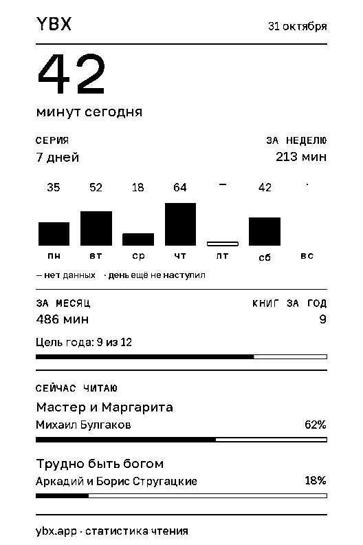

# YBX для CrossPoint

<p align="center">
  
</p>

<p align="center">
  <b>Яндекс Книги, WB Книги и ЛитРес на ридере</b><br>
  каталог и полки, скачивание EPUB, прогресс чтения и статистика — в плагине и на экране сна.
</p>

<p align="center">
  <a href="https://github.com/jhdvp/ybx-crosspoint-plugin/releases/latest"></a>
  
  
</p>

<p align="center">
  
</p>

## Что умеет

- **Каталог на ридере.** «Читаю», «Хочу прочитать», «Прочитано» и «Все книги» Яндекс Книг; WB Книги и ЛитРес — в connected-профиле. Поиск идёт по подключённым источникам сразу.
- **Скачивание EPUB.** Сервер отдаёт книгу по подписанной ссылке: токены магазинов остаются на сервере и не попадают на карту памяти.
- **Профиль и статистика** в веб-панели ридера (Settings → YBX): минуты, серия, неделя, достижения, цель года, текущие книги.
- **Экран сна со статистикой.** Карточка обновляется перед засыпанием и включается/выключается одним переключателем (см. ниже).
- **KOReader Sync.** Прогресс между ридерами через YBX — по кнопке; плагин не меняет настройки синхронизации молча.
- **Выгрузка статистики (vCodex).** Облачная статистика YBX кладётся на карту в формате, который понимает прошивка.

## Установка

**Plugin Hub — рекомендуемый путь.** На ридере: Home → Plugins → Plugin Hub → Community Plugins → **YBX** → Install. Hub ставит конкретный релиз и сам предлагает обновления.

**Если Hub недоступен:**

| Канал | Адрес |
| --- | --- |
| ZIP релиза | [releases/latest](https://github.com/jhdvp/ybx-crosspoint-plugin/releases/latest) — распакуйте так, чтобы получилось `/plugins/ybx/` (или `/.crosspoint/plugins/ybx/`) |
| Инсталлятор YBX | <https://ybx.app/installer> |
| Каталог плагинов | <https://ybx.app/crosspoint-plugin/catalog.json> |

При переустановке **сохраните** `token.json` и `config.json` — это вход в аккаунт и локальные настройки плагина.

## Экран сна: переключатель

Карточка статистики — это режим прошивки «Свой», который показывает файл `/sleep.bmp`, скачанный плагином.

**Settings → YBX → Экран сна** — одна кнопка в обе стороны:

- «Включать статистику на сне» ставит `sleepScreen = CUSTOM` («Свой»);
- «Выключить статистику на сне» возвращает `COVER` («Обложка» — обложку книги);
- рядом подписан текущий режим прошивки: «Свой», «Обложка», «Обложка + Свой», «Тёмный»…

Осторожно с режимом **«Обложка + Свой»**: в нём карточка появляется всякий раз, когда сон взят не из книги (из библиотеки, с домашнего экрана) или у книги нет обложки. Плагин считает этот режим включённым и подсказывает, что кнопка «Выключить» вернёт обложку.

## Первый вход

Откройте плагин на ридере → отсканируйте QR телефоном → войдите в кабинет YBX и подтвердите привязку. Плагин получит ключ устройства; сам аккаунт магазина остаётся на сервере.

## Совместимость

| Профиль | Что требует |
| --- | --- |
| **Stock** — публичный payload этого репозитория | CrossPoint 1.6.x и 2.0.x RC; пять статичных полок |
| **YBX Reader 1.7.x** — отдельная сборка | прошивка с `catalog.lists.auth`; меню источников собирается по подключениям аккаунта |

Устройства: Xteink X3, X4, X4 Pro (ESP32-C3 / ESP32-S3) и другие сборки CrossPoint с поддержкой плагинов.

## Версия 1.6.4

- Экран сна стал переключателем: раньше кнопка умела только включать, и выключённый режим нечем было вернуть из плагина.
- Текущий режим прошивки подписан словами вместо «другой режим».
- «Обложка + Свой» распознаётся как включённый и объясняется — это и была причина «выключил, а карточка всё равно приходит».

1.6.4 включает в себя всё из 1.6.2 и 1.6.3 без изменений: безопасную отвязку с отзывом ключей, восстановление KOSync после нового входа, экспорт статистики, который не угадывает отсутствие файла.

## Для мейнтейнеров

Этот репозиторий содержит **только payload релиза** — файлы, которые читает прошивка. Канонический исходник живёт в приватном репозитории YBX Server (`plugins/crosspoint/ybx`), публичный релиз обязан совпадать с ним байт в байт.

Релиз:

1. поднять версию в каноническом исходнике (`manifest.json`, `plugin.json`, `device.json`);
2. собрать и выкатить YBX Server — публичный эндпоинт установки;
3. скопировать runtime-файлы и проверить паритет:

   ```bash
   python3 tools/validate_payload.py --canonical /path/to/YBX-Site/plugins/crosspoint/ybx --sync
   python3 tools/validate_payload.py --canonical /path/to/YBX-Site/plugins/crosspoint/ybx
   python3 -m unittest discover -s tests -v
   ```

4. опубликовать stable GitHub Release с тегом `vX.Y.Z` и zip-ассетом `ybx-plugin-X.Y.Z.zip` (внутри — папка `ybx/`).

Plugin Hub индексирует репозиторий по неизменяемому релизному тегу и обновляет каталог сам; пин на конкретный тег — единственный способ гарантировать, что читатели получат ровно проверенные байты. CI этого репозитория проверяет структуру payload; кросс-репозиторное сравнение с приватным исходником выполняет CI сервера.

[Контракт Plugin Hub](https://github.com/crosspoint-reader/crosspoint-plugin-hub/blob/main/PLUGIN_HUB_CONTRACT.md) · [Прошивка CrossPoint](https://github.com/crosspoint-reader/crosspoint-reader) · [YBX](https://ybx.app)
