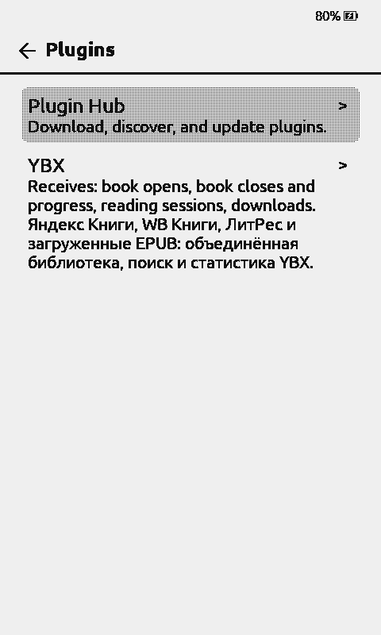
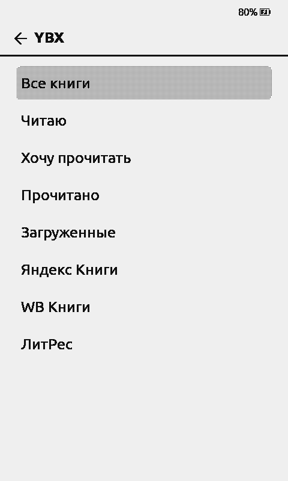
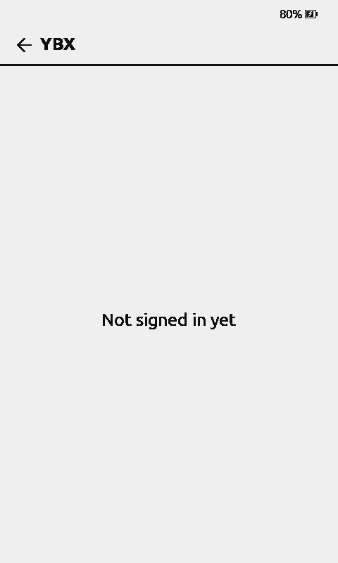

# Stock 1.6.14 — QEMU 11 reader smoke, 4 Nov 2026

This is a **real guest firmware / real virtual e-paper** smoke test, **not**
an account/EPUB/physical-device E2E acceptance.

## Environment

- Firmware: **stock CrossPoint 2.0.0 RC, X4 Pro**, from the independently
  saved verified 16 MiB flash image (`crosspoint-2.0.0rc-x4pro-flash-16m.bin`).
- Emulator: pinned official eink-qemu **0.9.2 / QEMU 11.1.2** in Docker.
- Data: an isolated **copy** of the pristine MBR/FAT16 test SD image; installed
  seven unmodified files from this PR's `ybx.crosspoint-plugin/` into
  `/plugins/ybx/`. The image contains **no** `token.json` or private account
  credentials. Existing emulator ports, user SD and firmware were not modified.
- Display: genuine UC8279/SSD1677-emulated **480×800** e-ink panel frames
  rendered from the real guest CPU, not HTML UI mocks.

## Verified from guest UART + EPD screenshots

- [x] CrossPoint stock firmware boots on X4 Pro in QEMU.
- [x] The guest mounts the isolated FAT16 SD using real SDMMC code.
- [x] Settings → Connectivity → Plugins initially displays Disabled.
- [x] Enabling Plugins exposes a **Plugins** entry on Home.
- [x] Plugins picker enumerates **YBX** from the 1.6.14 SD package,
  displays its YBX book-source description and retains the Plugin Hub option.
- [x] The packaged JSON still satisfies strict Stock API guards (no Native
  capabilities, no dynamic lists or JSON folder URL).
- [x] In a **second, isolated** QEMU 11 run, the official CrossPoint 2.0 RC
  firmware booted from a cloned FAT16 test SD with
  `/.crosspoint/settings.json` configured for enabled Plugins and never-sleep,
  and a deliberately **invalid synthetic** `/plugins/ybx/token.json`.
  The virtual X4 Pro discovered and connected to the emulated
  `PICSimLabWifi` access point.
- [x] Stock firmware rendered all **eight** static 1.6.14 lists in the
  real UC8279 e-paper frame: Все книги, Читаю, Хочу прочитать, Прочитано,
  Загруженные, Яндекс Книги, WB Книги, ЛитРес. This is the genuine
  `PluginCatalogActivity`, not a browser mock.
- [x] Selecting «Все книги» attempted real HTTPS; UART logged a TLS 1.3
  handshake and the guest safely displayed **Not signed in yet** for the
  invalid synthetic token, without disclosing credentials or crashing.
  This checks the unauthenticated failure state only, **not** a successful
  linked-account library download.
- [x] The guest image may safely be discarded and does not alter any account.

## Not verified

- [ ] User-approved QR/device-code pairing with a real authorized test account.
      The second guest intentionally used an **invalid synthetic token** only.
- [x] Static on-device navigation renders all **eight** lists before any
      book contents are fetched.
- [ ] Navigating actual **book contents** of each of those eight categories
      after successful authorization.
- [ ] WB/LitRes connected/unconnected and EPUB entitled download/open,
  remote KOSync, sleep card behavior and upgrading on actual hardware.
- [ ] TLS trust-root identity verification in the legacy stock ESP32 HTTP
  client (still tracked separately).

The guest accelerates time and eventually goes into Sleep, so a long
virtual touch may be interpreted as a long-press action. At one point
an **uninstall confirmation** appeared. The **Uninstall action was never
confirmed**, and the guest subsequently entered Sleep. No deletion was
verified. This is a disposable
isolated test card; production firmware and personal reader cards were
untouched.

**Release gate:** keep this public Stock PR, server package PR and stable
1.6.14 release **unmerged/unpublished** until the remaining acceptance
checks are supported by real QA. Current stable stays 1.6.13.
